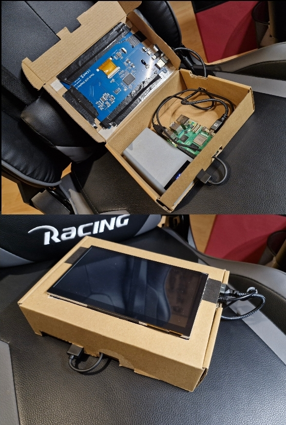

# Raspberry-Pi-Hacker-Projekt

Der Versuch, mit einem Raspberry Pi und zusätzlichen Komponenten ein tragbares Cybersecurity-Gerät nach dem Vorbild eines Flipper Zero zu bauen.

## Hintergrund

Mit 13 habe ich zu Weihnachten einen Raspberry Pi bekommen. Ursprünglich hatte ich ihn mir gewünscht, weil ich auf YouTube ein Tutorial gesehen hatte, in dem gezeigt wurde, wie man eine eigene Cloud mit Nextcloud aufbaut.

Als ich den Raspberry Pi dann hatte, kam mir allerdings eine andere Idee: Ein Freund von mir besaß einen Flipper Zero, und ich wollte etwas Ähnliches selbst bauen.

## Aufbau

Als Bildschirm habe ich mir einen 7-Zoll-Touchscreen besorgt. Mit einem Karton aus dem Keller, einer alten Powerbank, dem Touchscreen und dem Raspberry Pi habe ich den ersten Prototypen gebaut. Als Betriebssystem habe ich Kali Linux installiert.

Im Laufe des Projekts habe ich den Aufbau erweitert. Dazu kamen ein Alfa AWUS036ACS-WLAN-Adapter, ein USB-Hub und zusätzliche Lüfter.

Der externe WLAN-Adapter bot mir weitere Möglichkeiten für WLAN-Analysen. Er unterstützte unter anderem den Monitor Mode und die Paketinjektion, wodurch sich zusätzliche Funktionen für Tests und Analysen drahtloser Netzwerke nutzen ließen.

## Rückblick

Das Projekt war ein früher Versuch, verschiedene Hardware-Komponenten zu einem tragbaren Cybersecurity-Gerät zu kombinieren. Dabei konnte ich mit Kali Linux, zusätzlicher WLAN-Hardware und dem Aufbau eines eigenen Geräts experimentieren.

Das Gerät existiert heute nicht mehr. Die vorhandenen Bilder zeigen deshalb nur einen frühen Prototypen und nicht den später erweiterten Endzustand.

